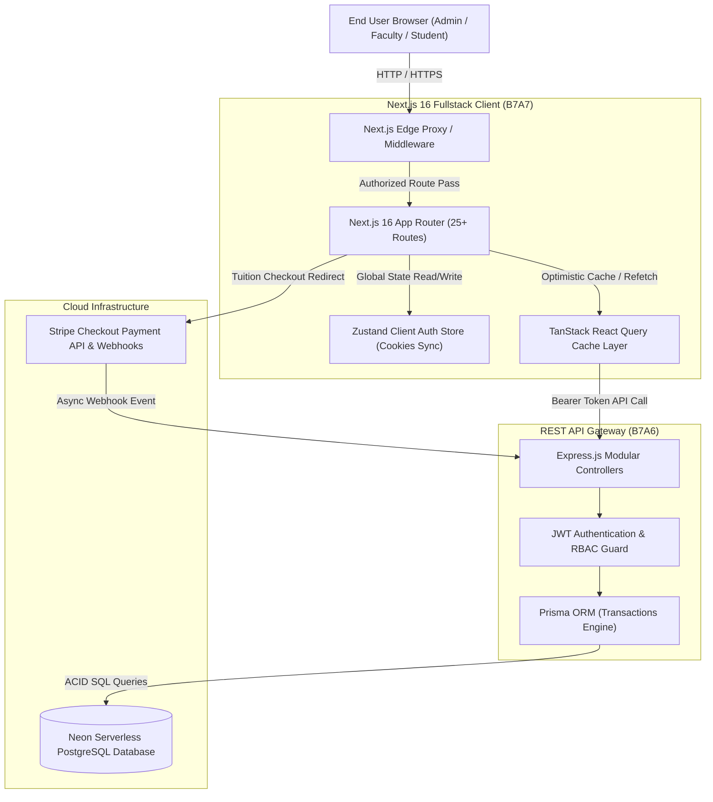

# Apex University Management System - System Architecture & Engineering Specifications

This document outlines the fullstack architecture, design patterns, state management strategies, and security models implemented across **Apex UMS**.

---

## 1. High-Level Architectural Flowchart



---

## 2. Directory Hierarchy & Code Organization

```
D:\level-2-assignments\B7A7
├── docs/                      # Architectural & Integration documentation
│   ├── API_INTEGRATION.md
│   └── ARCHITECTURE.md
├── src/
│   ├── app/                   # Next.js 16 App Router hierarchy
│   │   ├── (public)/          # /, /about, /academics, /tuition, /contact, /faq
│   │   ├── (auth)/            # /login (One-Click Demo), /register
│   │   ├── admin/             # Analytics, Departments, Courses, Semesters, Offerings, Users, Payments
│   │   ├── faculty/           # Schedule Overview, Section Rosters, Grading Matrix
│   │   ├── student/           # Summary, ACID Registration, Official Transcript, Stripe Invoices
│   │   ├── payment/           # /payment/success, /payment/cancel
│   │   ├── layout.tsx         # Root Layout with Font & Metadata
│   │   ├── globals.css        # Tailwind 4 & Print Directives
│   │   ├── sitemap.ts         # Dynamic XML Sitemap
│   │   ├── robots.ts          # Search Engine Crawler Directives
│   │   └── manifest.ts        # PWA Web App Manifest
│   ├── components/
│   │   ├── shared/            # Navbar, Footer, Sidebar, Header, StatCard, EmptyState
│   │   └── ui/                # Button, Card, Badge, Input, Skeleton, Modal
│   ├── hooks/                 # Custom React hooks (useDebounce)
│   ├── lib/                   # Universal utilities (api-client, export, grading, audio, security)
│   ├── providers/             # TanStack Query & Sonner Toast Providers
│   ├── store/                 # Zustand Persistent Authentication Store
│   ├── types/                 # Strict TypeScript Domain Interfaces
│   └── middleware.ts          # Edge Route Authentication Guard
└── src/__tests__/             # Vitest / Jest Unit Test Suites
```

---

## 3. State Management Taxonomy

### A. Persistent Auth Store (`Zustand`)
- Handles user identity (`User` object) and raw JWT token.
- Persists session in `js-cookie` (`apex_auth_token`, `apex_user_role`) so Next.js Edge Middleware can read session tokens synchronously without client rehydration delay.
- Exposes `loginWithCredentials`, `loginWithDemoRole`, and `logout` actions.

### B. Remote Server State (`TanStack React Query v5`)
- Handles caching, pagination, deduplication, and automatic invalidation.
- Keys structured systematically: `["admin", "departments"]`, `["faculty", "sections"]`, `["student", "transcript"]`.
- Mutations trigger targeted `queryClient.invalidateQueries()` for instantaneous UI synchronization.

---

## 4. Multi-Tier Security Architecture

1. **Edge Protection (`middleware.ts`):** Unauthenticated requests to `/admin/*`, `/faculty/*`, or `/student/*` are intercepted before rendering and redirected to `/login?redirect=...`.
2. **Role-Based Routing Isolation:** A student attempting to access `/admin` or `/faculty` is rerouted to `/student` automatically.
3. **HTTP Client Interceptor (`api-client.ts`):** Attaches `Authorization: Bearer <token>` on all outbound calls; intercepts `401 Unauthorized` responses to clear cookies and redirect cleanly.
4. **Input Sanitization (`security.ts`):** Strips `<script>` tags, inline event attributes (`onload=`, `onerror=`), and checks password entropy prior to transmission.
